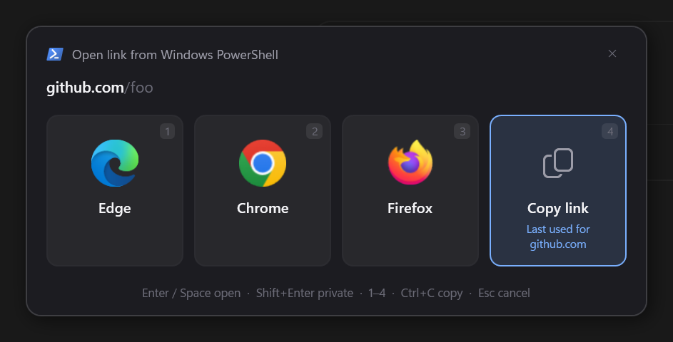

# BrowserFork

[](https://github.com/AlxndrJhn/BrowserFork/actions/workflows/ci.yml)

A tiny browser picker for Windows 11. Set it as your default browser, and every link you open
pops up a small topmost window with your installed browsers, plus **Copy link**.



- Lists every browser registered with Windows (Edge, Chrome, Firefox, Brave, …) with its own icon,
  and one tile per profile for browsers that have several (Chromium browsers and Firefox).
- Preselects the browser you're most likely to want, and says why: *Last used from Outlook*,
  *Last used for github.com*, *Used last time*.
- Forwards the original arguments to the chosen browser exactly as received.
- Keyboard first: the preselected tile has focus, so Enter just goes.
- *Always open links from this app this way* skips the picker for that app from then on.
- A tray icon for settings and updates from GitHub releases.

## Install

Requires Windows 10/11 and the [.NET 10 Desktop Runtime](https://dotnet.microsoft.com/download/dotnet/10.0).

**With the setup (recommended):** download `BrowserFork-Setup.exe` from
[Releases](https://github.com/AlxndrJhn/BrowserFork/releases) and run it. It installs to Program Files,
registers BrowserFork, starts the tray icon and offers to make it the default browser. Only setup installs can
update themselves.

**Just the exe:** download `BrowserFork.exe` from the same page, put it somewhere permanent, then run:

```powershell
.\BrowserFork.exe --register-machine   # as administrator, once
.\BrowserFork.exe --register
```

**From source** (needs the .NET 10 SDK):

```powershell
.\install.ps1
```

This builds to `%LOCALAPPDATA%\Programs\BrowserFork`, asks for admin once, and registers the app.

Then choose **BrowserFork** in *Settings › Apps › Default apps*. Windows deliberately doesn't let apps
make themselves the default browser, so the setup's last page (or `BrowserFork.exe --set-default`, or
**Make default browser…** in the tray) opens that page with a small helper beside it. The helper shows
what HTTP and HTTPS should look like and ticks each one off once Windows reports BrowserFork for it.

> **Why admin?** Windows accepts a per-user (HKCU) browser registration, but *Settings › Default
> apps* only lists the app once it's also registered machine-wide (HKLM), like regular browser
> installs.

To uninstall a setup install, use *Settings › Apps › Installed apps*. Otherwise run
`BrowserFork.exe --unregister` as administrator and delete the folder.

## Use

| Key | Action |
| --- | --- |
| Enter / Space / click | open in the focused browser |
| Shift + Enter / click | open in a private window |
| 1 – 9 | pick a tile directly |
| ← → | move focus |
| Ctrl + C | copy the link instead of opening it |
| Alt + A | tick *Always open links from this app this way* |
| Esc | cancel |

## Profiles

Browsers with more than one profile get one tile per profile, with the profile's name under the browser's.
BrowserFork reads them from `Local State` in the browser's *User Data* folder (Edge, Chrome, Brave,
Vivaldi, …) or from `profiles.ini` (Firefox, LibreWolf, Waterfox), and opens the link with
`--profile-directory` or `-P`. Browsers with one profile keep a single tile.

## Always for this app

Tick *Always open links from Outlook this way* (Alt + A) before choosing, and links from that app go
straight to the chosen browser and profile, private if you chose a private window. Hold **Shift** while
clicking a link to get the picker anyway. Remove rules in the tray icon's **Settings**.

## Tray icon and updates

`BrowserFork.exe --tray` puts an icon in the notification area: **Settings…** (rules, start with Windows,
automatic updates), **Check for updates**, **Make default browser…** and **Exit**. The setup starts it with Windows
unless you untick that option. The Start menu shortcut opens Settings.

Once a day the tray checks the [latest release](https://github.com/AlxndrJhn/BrowserFork/releases/latest).
If you installed with the setup and automatic updates are on, it downloads the new `BrowserFork-Setup.exe`
and runs it silently; Windows asks for admin permission. Otherwise it shows a notification you can click.

## How the preselection works

BrowserFork works out which app opened the link from its parent process. If the launch came
through a broker such as explorer or svchost, it uses the window that was in the foreground instead.
The focused tile is the last choice made:

1. **from the same app**, otherwise
2. **for the same host** (`www.` ignored), otherwise
3. **overall**.

History is stored in `%APPDATA%\BrowserFork\history.json`, rules and settings in `settings.json` next to it.

## Reporting a problem

Tick *Settings › Keep a log for problem reports*, then make the problem happen again. Nothing is logged
until you do, and unticking it deletes the log. The log (`%APPDATA%\BrowserFork\log.txt`) records which
app a link came from, which choice was preselected and picked, and any errors. Links are reduced to their shape
(`https://<host>/<path>?<query>`), and user names, the computer's name, e-mail addresses and paths under
`C:\Users` are removed before anything is written. Profiles are logged by position, not by name.

*Settings › Save anonymized log…* saves that log with a summary of your setup (version, browsers, rules)
to attach to a [GitHub issue](https://github.com/AlxndrJhn/BrowserFork/issues/new). Have a look at it
before you share it. *Open issues on GitHub* shows the problems already reported.

## Limitations

- Windows sends some links straight to Edge, such as Start menu search results and Widgets
  (`microsoft-edge:` links). Those never reach the default browser, so BrowserFork can't catch them.
- Profiles are listed as the browser records them. Firefox keeps old profiles in `profiles.ini` after a
  new one replaces them, so an unused *default* profile may show up next to *default-release*.

## Development

```powershell
dotnet build BrowserFork.slnx
dotnet test BrowserFork.slnx
```

CI builds and tests every push and pull request, and builds `BrowserFork-Setup.exe` with
[Inno Setup](https://jrsoftware.org/isinfo.php) from [installer/BrowserFork.iss](installer/BrowserFork.iss).
Pushing a `v1.2.3` tag builds version 1.2.3 and publishes a release with `BrowserFork-Setup.exe` and
`BrowserFork.exe` attached. The tray's updater uses that release. Its notes list the commits since the
previous tag ([.github/release-notes.sh](.github/release-notes.sh)): subjects starting with *Add* go under
*New features*, *Fix* under *Bug fixes*, and the bullet lines of each commit message are included.

To build the setup locally (needs Inno Setup 6):

```powershell
dotnet publish src/BrowserFork.csproj -c Release -r win-x64 --self-contained false -p:PublishSingleFile=true -p:PublishReadyToRun=true -o dist
& "${env:ProgramFiles(x86)}\Inno Setup 6\ISCC.exe" /DAppVersion=1.2.3 installer\BrowserFork.iss
```

## License

[MIT](LICENSE)
